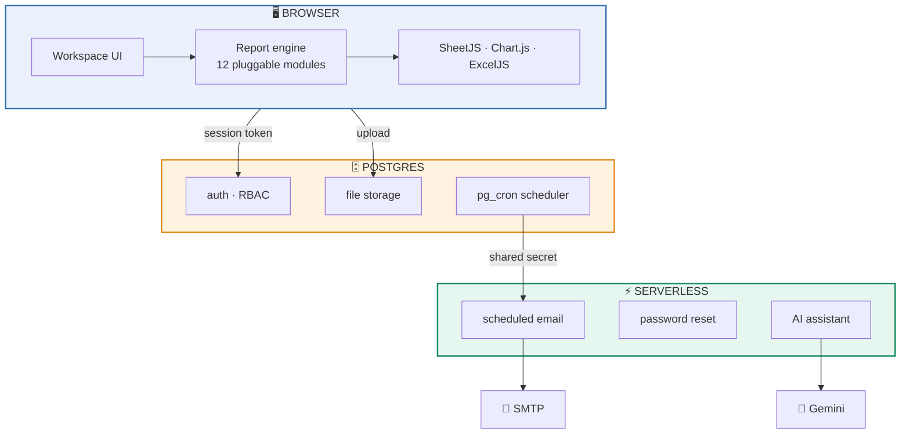

<div align="center">


# VIESL Report Analyzer

### Replacing days of manual Excel work with a browser-based reporting platform 

A production system at an infrastructure company, built to migrate **12 legacy
Excel reports** onto an automated platform without changing a single number.

<br>


<br>

[**Live demo**](https://jolly-dune-01ca78a00.3.azurestaticapps.net/) &nbsp;·&nbsp;
[The hard part](#-the-hard-part-making-the-numbers-match) &nbsp;·&nbsp;
[Architecture](#-architecture) &nbsp;·&nbsp;
[Bugs worth reading about](#-four-bugs-worth-reading-about) &nbsp;·&nbsp;
[Operations docs](OPERATIONS.md)

</div>

---

## The problem

An infrastructure company runs heavy equipment across 100+ sites. Every month, finance
and operations exported raw dumps from the ERP and rebuilt **twelve reports by hand** in
Excel — nested formulas, manual pivots, copy-paste between sheets.

It took days. It was error-prone. And only the person who built each workbook understood
how it worked.

## What I built

A single-page web application where a user uploads the raw ERP export and immediately
gets KPIs, charts, filterable tables, and a formatted Excel workbook matching the
original report sheet-for-sheet.

```
   ┌──────────┐     ┌──────────┐     ┌──────────┐     ┌──────────┐
   │  SELECT  │ ──▶ │  UPLOAD  │ ──▶ │ ANALYSE  │ ──▶ │  EXPORT  │
   │  report  │     │ ERP dump │     │ live KPIs│     │  Excel   │
   │  module  │     │  as-is   │     │ & charts │     │ workbook │
   └──────────┘     └──────────┘     └──────────┘     └──────────┘

   no manual cleaning · parsed in the browser · matches the reference
```

**"As-is" is the point.** The file isn't tidied first. The parser handles headers that
aren't on row one, columns renamed between months, a sheet name that's genuinely
misspelled in the ERP, and thousands of trailing blank rows.

---

## 📊 Scale

<div align="center">

| | | | |
|:---:|:---:|:---:|:---:|
| **12** | **18,000+** | **545** | **0** |
| report modules | rows per monthly dump | tracked assets | mismatches allowed |
| **121** | **70** | **63** | **2** |
| KPI cards | charts | secured DB functions | live deployments |

</div>

Four business areas — Plant & Machinery, Purchase & Store, Sales, Accounts — serving
finance and operations users daily.

---

## 🎯 The hard part: making the numbers match

Building the dashboard was the easy half. The hard half was **fidelity**: proving the
new report produces the same numbers as the workbook it replaces.

### The method

I didn't infer what each report *meant*. I opened every reference workbook and read its
**actual formulas** — `SUMIFS`, `COUNTIFS`, nested `IF` chains — then reimplemented them
and verified in Python at three levels:

```
✓  Grand total      to the paisa
✓  Per row          every row against its reference row
✓  Per column       each column total independently

Pass criterion:  zero mismatches.  Not "close enough".
```

Checking all three matters, because **a grand total can be right by accident.** Two
offsetting errors produce a correct total with wrong rows — the worst outcome, because
it looks verified.

> Every time I assumed intent instead of reading the formula, I was wrong. That's the
> single most useful lesson this project taught me.

---

## 🐛 Four bugs worth reading about

Each of these came from the validation catching a mismatch I would never have guessed.

<table>
<tr><td width="50%" valign="top">

### Excel's `TRIM` isn't `trim()`

My Outstanding report found **331** distinct parties. The reference had **328**.

Excel's `TRIM()` also collapses runs of spaces *inside* a value, not just at the ends.
So `ABC␣␣PVT LTD` and `ABC␣PVT LTD` are one party in Excel and two in JavaScript.

```js
const xlTrim = v =>
  String(v).replace(/\s+/g, ' ').trim();
```

</td><td width="50%" valign="top">

### A date column that didn't matter

The Fleet Loan report said **392** EMIs due. I got **390**.

I was filtering on the EMI day-of-month — the obvious reading. Reading the actual
`COUNTIFS` showed it never references that column at all.

The real rule: loan active during the month, **and** a balance outstanding. The EMI date
is irrelevant.

</td></tr>
<tr><td width="50%" valign="top">

### Every date was one day early

Reading Excel dates in IST, SheetJS applies India's *1900-epoch* offset, which differs
from today's +05:30 by ten seconds. Every date landed at **23:59:50 the previous day**.

All 18,205 rows affected. Anything dated the 1st fell into the previous month, inventing
532 phantom summary rows.

Fixed by snapping values within two minutes of midnight — leaving genuine times of day
untouched.

</td><td width="50%" valign="top">

### Emails showing filtered figures

A user reported the scheduled email showing roughly half the total the report showed on
screen — and 364 ledger accounts against a file containing 319 records.

**Two independent root causes.** The snapshot captured the *filtered* view the user
happened to be looking at. And deeper, the payload query joined "newest upload" and
"latest snapshot" independently, pairing data from two different files.

</td></tr>
</table>

> The second bug was really a **data freshness and lineage** problem — I was manually
> correlating two tables by timestamp and getting it wrong. On a proper data platform,
> versioning and lineage remove that class of bug entirely. I'd hand-rolled a weak
> version of something a platform gives you.

---

## 🏛 Architecture

The core decision: **ERP data never leaves the user's browser.** Files are parsed
client-side, so financial data doesn't transit a server to be analysed. Server-side code
exists only where a secret must stay hidden.



| Decision | Reasoning |
|---|---|
| **Client-side processing** | Financial data stays on the user's machine. Zero compute cost. |
| **Registry-driven modules** | A new report is one registry entry — menu, filters, permissions and exports come free. |
| **Serverless only for secrets** | Anything in the browser is readable by the user. |
| **`pg_cron` as scheduler** | The database is already always-on. No extra service. |
| **Defensive parsing** | Sheet aliasing, header detection, column alias mapping — source schemas drift monthly. |

---

## ⚡ Performance

Profiled rather than guessed. Both wins were algorithmic, not library swaps — and both
were proven **output-identical** before shipping.

| Change | Result | Verification |
|:---|:---|:---|
| Cached number formatters instead of constructing one per value | **38× faster** | byte-identical across 300,000 values, including `NaN` and `null` |
| Rewrote cascading filters to count failures in a single pass | **3.8× faster** | identical available-value sets for every filter combination |
| Lazy chart construction via `IntersectionObserver` | only visible charts built | rendered data unchanged; only animation removed |
| Trimmed 100,000 padded rows the ERP exports down to 18,206 real ones | 82% fewer rows parsed | proven to drop only rows containing zero cells |

> A speed-up that changes a number isn't an optimisation — it's a bug with a benchmark
> attached. Every performance change here had to prove it changed nothing else.

---

## 🧰 Built with

| Layer | Technology |
|:---|:---|
| **Frontend** | Vanilla JavaScript (ES6), HTML5, CSS3 — single file, no build step |
| **Data processing** | SheetJS (parsing), ExcelJS (styled exports), Chart.js |
| **Backend** | PostgreSQL via Supabase — 11 tables, 63 secured functions, RLS |
| **Serverless** | Node.js functions on Vercel and Azure Functions |
| **Scheduling** | `pg_cron` + `pg_net` |
| **Validation** | Python (openpyxl, pandas) for cell-by-cell reconciliation |
| **Hosting** | Vercel (`main`) and Azure Static Web Apps (`Azure-deploy`) |
| **Security** | bcrypt, session tokens, row-level security, OTP password reset |

### Running on two clouds

The same application is deployed to **Vercel and Azure from two branches**, sharing one
database. The Azure branch is `main` plus nine files — an adapter translates the Vercel
function signature to the Azure Functions model, so the business logic stays
byte-identical on both and a bug is never fixed twice.

---

## 🔍 What I'd do differently

Stated plainly, because knowing the limits of your own design matters more than defending it.

| Limitation | Why it exists | The right fix |
|:---|:---|:---|
| **No history** — each upload replaces the last | there's no storage layer between the raw file and the report | land raw files immutably, so you can ask "what changed?" |
| **Validation is manual** | the checks are Python scripts I run, not tests in CI | convert them into pipeline assertions that gate every load |
| **Email figures come from a snapshot** | numbers are computed in the browser; the mailer has no browser | compute server-side, read from versioned tables |
| **Bounded by one machine's memory** | all processing is client-side | distributed compute once data outgrows a laptop |

The honest summary: this is a **correctness and migration-fidelity** project, not a
big-data one. The volumes are thousands of rows, not millions. What it demonstrates is
reverse-engineering legacy logic, validating to a zero-mismatch bar, and debugging
production data defects — the unglamorous parts that decide whether a migration
succeeds.

---

<div align="center">

### Built by

**Harshal Khadatare** — Data Engineer

[LinkedIn](https://linkedin.com/in/harshal-khadatare) &nbsp;·&nbsp;
[GitHub](https://github.com/harshalkhadatare) &nbsp;·&nbsp;
khadtareharshal2002@gmail.com

<sub>Report requirements by <b>Sandeep Patil</b> — Manager, P&M / Audit<br>
Built at <b>Vision Infra Equipment Solutions Ltd</b>, Pune · © 2026 · All rights reserved</sub>

<br>

<sub>Looking for setup, deployment or troubleshooting docs? → <a href="OPERATIONS.md">OPERATIONS.md</a></sub>

</div>
